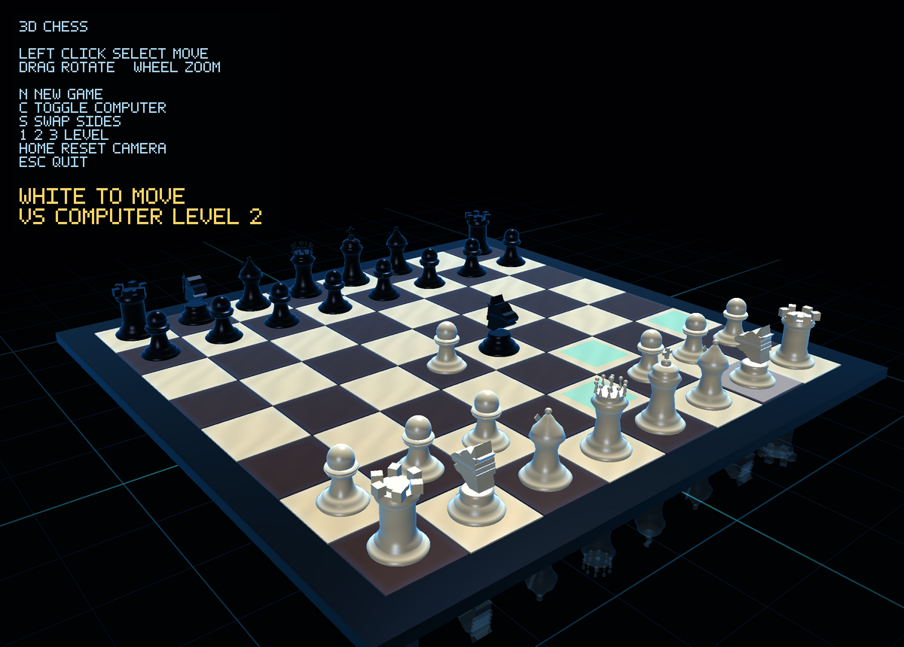

# 3D Chess — Rust and OpenGL 4

[](https://github.com/sponsors/makarov-mm)
[](LICENSE)


[](https://www.linkedin.com/in/makarov-mm/)
[](https://www.threads.net/@m.m.makarov)
[](https://www.instagram.com/m.m.makarov/)

A small 3D chess pet project written in Rust on raw OpenGL 4: the Rust version of the C# WinForms project, with the same rules, computer player, graphics and controls.

The project renders a 3D chess board with OBJ-based chess pieces, GLSL shaders, lighting, reflections and mouse interaction. It is not based on a game engine or a 3D framework — the rendering pipeline, model loading, camera control and board interaction are implemented manually. The models and the shaders are built into the executable, so the game is a single file.



## Features

- 3D chess board rendered with OpenGL 4 (core profile, multisampled, vertical sync)
- Chess pieces loaded from `.obj` models
- GLSL shader-based rendering: lighting, glossy materials, reflections in a glowing floor grid
- Camera rotation and zoom with the mouse; the camera starts on the player's side
- Mouse picking for selecting pieces and board squares
- Highlighting of the selected piece and its legal moves
- Complete chess rules: castling, en passant, promotion, check, checkmate, stalemate, draws by repetition, by the fifty-move rule and for lack of material
- Computer opponent: alpha-beta search with three levels; it thinks on a thread of its own, so the window stays responsive
- The overlay follows the scale of the screen
- No game engine: the only crates are those for the window, the OpenGL context and the OpenGL functions

## Controls

| Action | Control |
|---|---|
| Select piece / move | Left mouse click |
| Deselect | Click the selected piece again |
| Rotate camera | Hold and drag mouse |
| Zoom | Mouse wheel |
| New game | `N` |
| Computer opponent on / off | `C` |
| Swap sides with the computer | `S` |
| Computer level | `1`, `2`, `3` |
| Reset camera | `Home` |
| Close | `Esc` |

## Technical details

The goal of this project was not to build a strong chess engine, but to combine several low-level graphics and interaction systems in one understandable Rust project:

- An OpenGL 4.0 core context on a `winit` window through `glutin`, on a multisampled pixel format
- GLSL shader compilation and linking
- OBJ model loading
- 3D camera, vectors and projection matrices
- Rendering of multiple mesh instances
- Mouse ray picking
- Board state, move generation and legality checks
- A computer player searching a few moves ahead on another thread, which wakes the window when the move is found
- Visual feedback for interaction

## Requirements

- Windows 10 or 11, or Linux (X11 or Wayland), x64
- A graphics card and driver with OpenGL 4.0
- Rust 1.85 or later (the 2024 edition)

## Building and running

```sh
cargo run --release
```

The executable is `target/release/chess3d` (`chess3d.exe` on Windows) and runs on its own.

## Project structure

```text
.
├── models/            chess piece models (.obj), built into the executable
├── shaders/           chess.vert, chess.frag, built into the executable
├── src/
│   ├── main.rs        entry point
│   ├── app.rs         window, input, game flow, computer moves in the background
│   ├── renderer.rs    scene drawing: board, pieces, reflections, highlights, text overlay
│   ├── camera.rs      orbit camera, projection, mouse picking
│   ├── chess.rs       pieces and moves, chess rules and the computer player
│   ├── mesh.rs        vertex buffers, generated meshes, the pixel font
│   ├── obj.rs         OBJ model loader
│   ├── gfx.rs         the shader program and the OpenGL state
│   ├── math.rs        vectors and matrices
│   └── platform.rs    OpenGL context on a window
├── Cargo.toml
└── screenshot.png
```

## Dependencies

| Crate | For |
|---|---|
| `winit` | the window and its input |
| `glutin`, `glutin-winit`, `raw-window-handle` | the OpenGL context |
| `gl` | the OpenGL functions |

## Notes

This is a graphics programming experiment, not a production chess application. The player's pawns always promote to queens, and the computer searches to a fixed depth (2 to 4 half-moves) without a quiescence search, so it plays a modest game.

The interesting part of the project is the rendering and interaction pipeline: drawing a complete 3D scene, selecting pieces with the mouse, loading models, working with shaders and keeping the board state synchronized with what is shown on screen.

## License

MIT License

Copyright (c) 2026 Mykhailo Makarov

Permission is hereby granted, free of charge, to any person obtaining a copy
of this software and associated documentation files (the "Software"), to deal
in the Software without restriction, including without limitation the rights
to use, copy, modify, merge, publish, distribute, sublicense, and/or sell
copies of the Software, and to permit persons to whom the Software is
furnished to do so, subject to the following conditions:

The above copyright notice and this permission notice shall be included in all
copies or substantial portions of the Software.

THE SOFTWARE IS PROVIDED "AS IS", WITHOUT WARRANTY OF ANY KIND, EXPRESS OR
IMPLIED, INCLUDING BUT NOT LIMITED TO THE WARRANTIES OF MERCHANTABILITY,
FITNESS FOR A PARTICULAR PURPOSE AND NONINFRINGEMENT. IN NO EVENT SHALL THE
AUTHORS OR COPYRIGHT HOLDERS BE LIABLE FOR ANY CLAIM, DAMAGES OR OTHER
LIABILITY, WHETHER IN AN ACTION OF CONTRACT, TORT OR OTHERWISE, ARISING FROM,
OUT OF OR IN CONNECTION WITH THE SOFTWARE OR THE USE OR OTHER DEALINGS IN THE
SOFTWARE.

## Support

If you found this project interesting or useful, you can support my work:

[](https://github.com/sponsors/makarov-mm)
